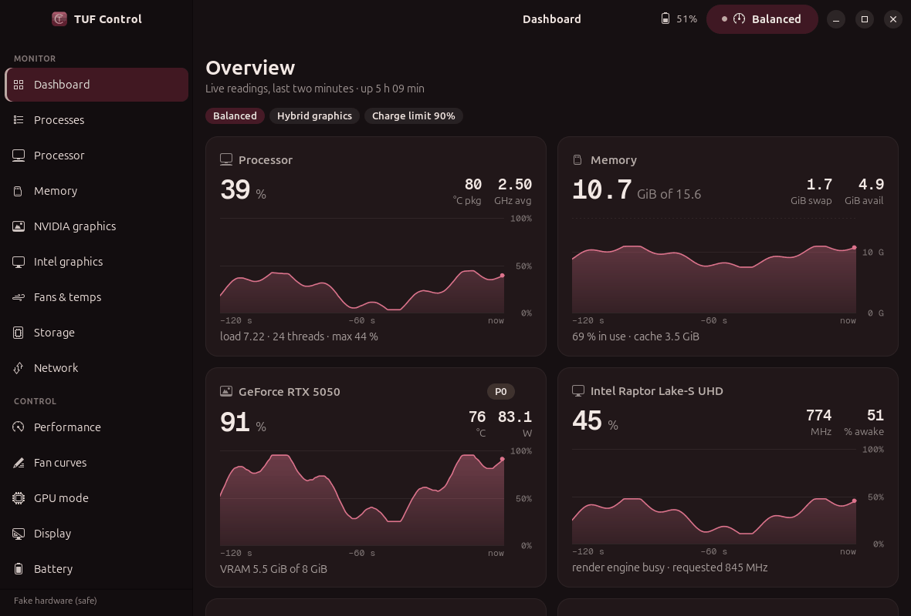
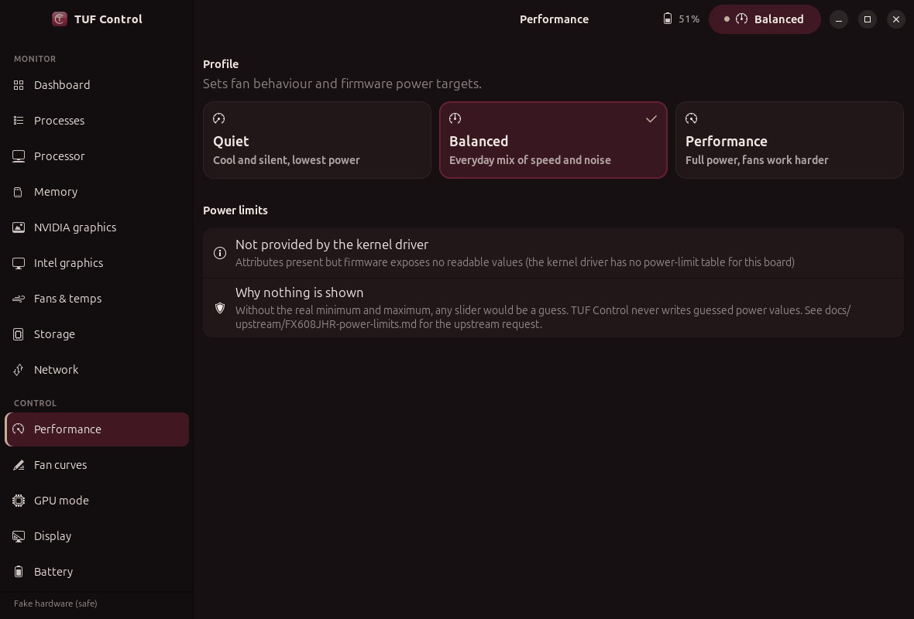
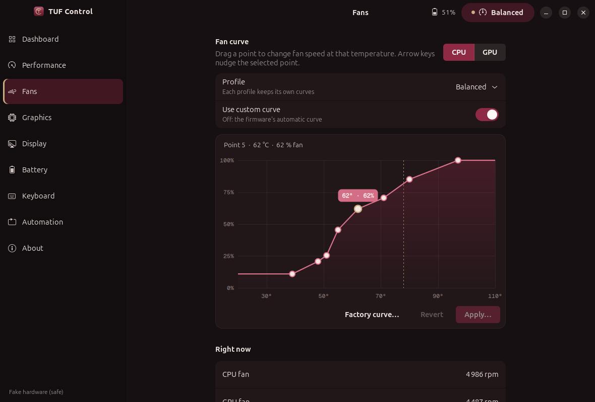
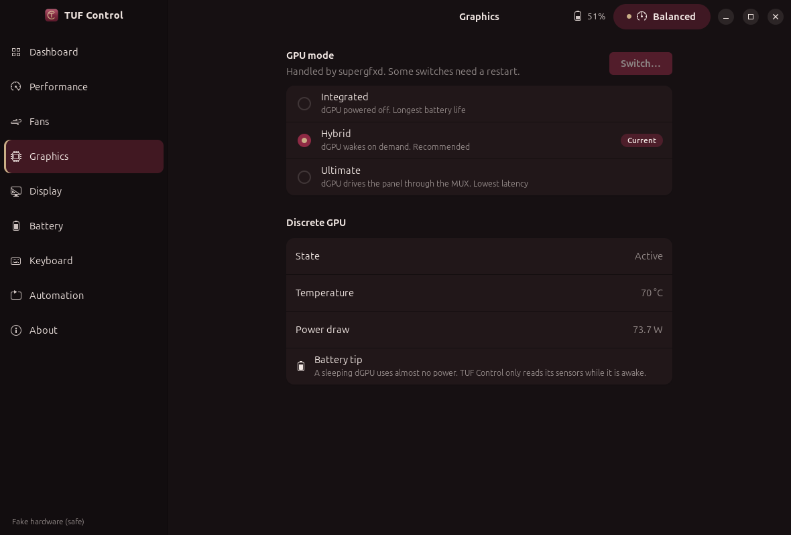
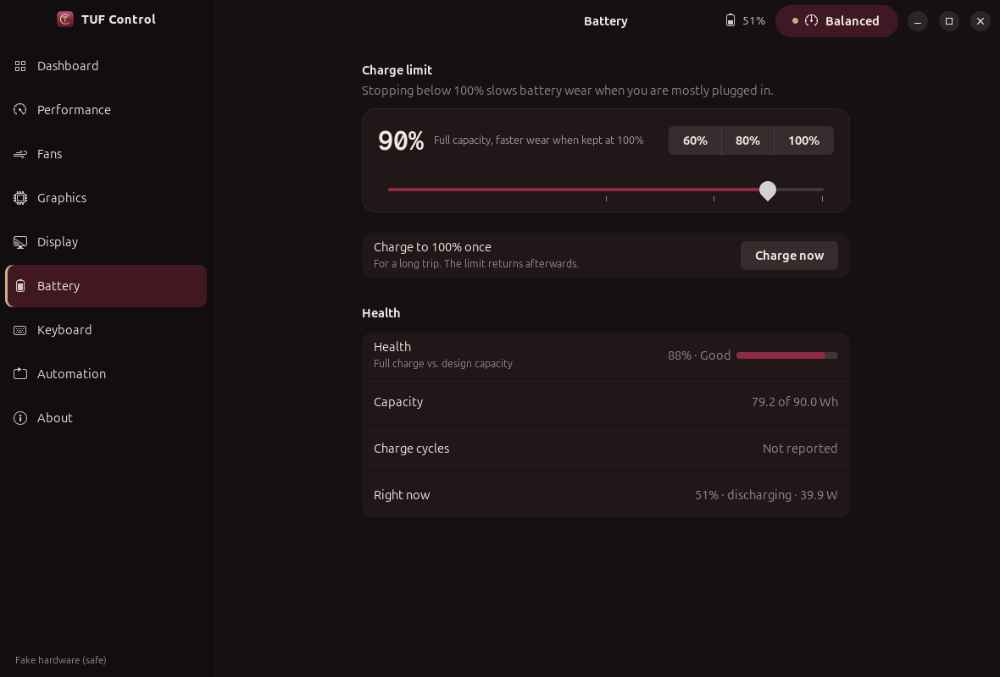
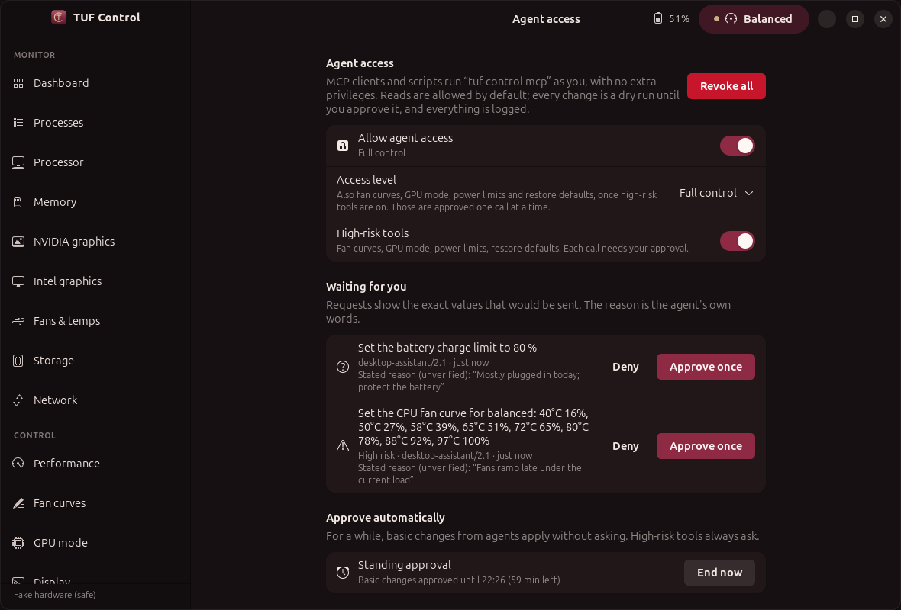

# TUF Control

A native control app for ASUS TUF and ROG laptops on Linux: performance profile, power
limits, fan curves, GPU mode, battery charge limit, keyboard lighting and display options,
in a GTK 4 / Libadwaita interface, a CLI, and a GNOME Quick Settings toggle.

<p align="center">
  
  
</p>

## Features

- **Performance**: Quiet / Balanced / Performance profile; PPT power limits when the
  firmware exposes them.
- **Fans**: 8-point curve per fan and profile (drag or arrow keys), apply / revert / factory reset.
- **Graphics**: Integrated / Hybrid / Ultimate through supergfxd, with the pending-restart state.
- **Battery**: charge limit 20-100 %, one-shot full charge, health.
- **Keyboard**: brightness and hardware effects with a live preview.
- **Display**: refresh rate (with Undo), panel overdrive.
- **Monitor**: a dashboard of live cards and detail pages for processes/apps (with End task),
  per-core CPU, memory, both GPUs, both fans and temperatures, storage and network. About half
  of Mission Center's memory (107 MB vs ~210 MB), checked against `top`, `free`, `sensors`,
  `nvidia-smi` and `upower` ([PERFORMANCE.md](docs/PERFORMANCE.md)). The dGPU is never woken
  to read sensors.
- **CLI**: `tuf-control status | profile | limit | battery ...`, `--json`, `--dry-run` on every write.
- **Agent access**: an MCP server (`tuf-control mcp`) and JSON CLI for agents and scripts.
  Read-only by default; every change is a dry run until you approve it. See below.
- **Quick Settings**: a "Performance" toggle with a profile submenu, GPU mode and charge limit
  readouts. Follows the shell theme.

<p align="center">
  
  
  
</p>

Light theme and narrow layouts are in [docs/screenshots](docs/screenshots/).

## Comparison

Armoury Crate and G-Helper are Windows programs; this table compares what each offers, not a
drop-in replacement. "Partial" means present but narrower than the original.

| | Armoury Crate (Windows) | G-Helper (Windows) | TUF Control (Linux) |
| --- | --- | --- | --- |
| Performance profiles | yes | yes | yes |
| PPT power limits | yes | yes | yes, if firmware exposes them (see limitations) |
| Fan curves | yes | yes | yes |
| GPU mode (Eco / Standard / Ultimate) | yes | yes | yes, via supergfxd |
| Charge limit | yes | yes | yes |
| Keyboard RGB effects | yes (Aura Sync) | yes | partial: hardware effects only |
| Per-app / AC-battery automation | yes | yes | in progress |
| Resource use | heavy background services | light | light, no background service |
| Open source | no | yes | yes (GPL-3.0-or-later) |
| Runs on Linux | no | no | yes |

## Limitations (honest)

- **PPT group unavailable on some firmware.** With `asusd`'s `EnablePptGroup` off, or on models whose
  firmware does not report PPT values (they read as -1), the power-limit sliders are hidden and the
  app says why. It never invents limits. Enabling `EnablePptGroup` is your call and model dependent.
- Fan curves exist only for fans the firmware lists; through plain sysfs only the active profile's
  curve can be edited.
- Keyboard: hardware effects only; software effects are a placeholder. Per-key RGB is not supported.
- GPU mode changes need a log-out or reboot; supergfxd decides, the app only shows the required action.
- The D-Bus names and signatures were checked read-only against asusd 6.3.5 and supergfxd; the write
  paths have been tested with a recording transport and a fake sysfs tree, not exercised on every
  model. Daemons were introspected on one TUF laptop only.
- GNOME Shell 46 is the only version the Quick Settings extension declares.

## Install

    ./install.sh --dry-run
    ./install.sh
    gnome-extensions enable tuf-control-quick@hamza-gouda

See [docs/INSTALL.md](docs/INSTALL.md). User-level, no root, no downloads. The optional polkit
helper is printed with `./install.sh --system` and never run for you.

The installer also binds the Armoury Crate key (XF86Launch3) to open or raise TUF Control as a GNOME
custom shortcut; skip it with `--no-hotkey`, pick another key with `--hotkey=KEYSYM`.

## Usage

    tuf-control status
    tuf-control profile set quiet --dry-run
    tuf-control battery limit 80
    tuf-control-gui

Development without hardware: `TUF_CONTROL_FAKE_ROOT=/tmp/tree tuf-control status` (see
[docs/UI.md](docs/UI.md)).

## Agent access

Agents use the app through a protocol instead of a window. `tuf-control mcp` is a Model
Context Protocol server (JSON-RPC over stdio, standard library only) with read tools
(status, telemetry, processes, fan curves, battery health, automation rules, "why is this
unavailable"), write tools for profile, charge limit and keyboard, and high-risk tools for
fan curves, GPU mode, power limits and restoring defaults.

    tuf-control mcp --print-config          # client config snippet
    tuf-control agent grant control-basic   # allow change requests (each one approved by you)
    tuf-control agent pending | approve ID | deny ID | audit | revoke

- Read-only by default; only you raise the level (Agent access page or `agent grant`).
- Writes are dry runs unless `dry_run: false` **and** you approved: once per call, or with a
  time-boxed grant (`--for 1h`) for the basic tools. High-risk tools are off until you enable
  them and always ask per call.
- Hardware bounds enforced through the same Controller, rate limits, strict schemas with no
  path or command parameters, untrusted process names cleaned and marked, an audit log,
  and a kill switch (`tuf-control agent revoke`, **Revoke all** on the page).

<p align="center">
  
</p>

Tools, safety model, threat model and an example session: [docs/AGENT_API.md](docs/AGENT_API.md).

## Architecture

```
 GTK app  |  CLI  |  GNOME Quick Settings extension (talks to the bus itself)
    \        |
     Controller  -- picks a backend per capability, reports why something is unavailable
        |
   +----+-----------+-----------+
 D-Bus (asusd,     sysfs        asusctl CLI
 supergfxd, PPD)   (+ writer)   (allow-listed args)
                      |
              direct write -> EACCES -> pkexec tuf-control-helper (allow-listed)
```

Details: [docs/ARCHITECTURE.md](docs/ARCHITECTURE.md), [docs/UI.md](docs/UI.md).

## Safety model

- Every write is validated against the firmware's own min/max before it is sent; dry runs never write.
- Confirmation dialogs for power limits, fan curves and GPU mode.
- The app runs as you. Privileged work is done by `asusd`, or by a tiny root helper that only
  accepts exact sysfs paths and values, resolves symlinks, uses no shell, and sits behind a
  polkit prompt (`auth_admin_keep`). It is optional and installed by you.
- The CLI wrapper uses an argument allow-list and no shell. Tests run on a fake tree and never touch hardware.

## Development

    PYTHONPATH=src python3 -m unittest discover -s tests
    shellcheck install.sh uninstall.sh tests/test_install.sh && bash tests/test_install.sh
    gjs -m tests/test_quick_profiles.js

## Credits and license

Written by Hamza Gouda. Built on the work of the asus-linux project (asusd, supergfxd) and the
kernel's asus-wmi and asus-armoury drivers; this project is not affiliated with ASUS.
GPL-3.0-or-later, see [LICENSE](LICENSE).
