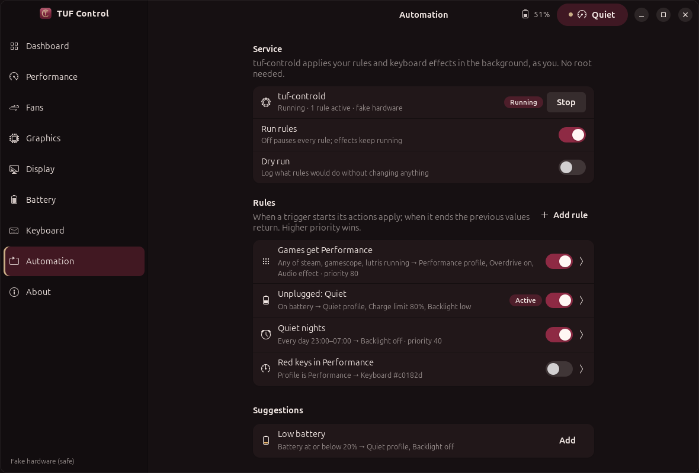

# Automation

Rules change settings when something happens: plug in, unplug, battery drops, a game
starts, a time window begins, the profile changes. They run in `tuf-controld`, a small
per-user daemon. No root: every write goes through the same `Controller` the GUI uses, so
firmware bounds and backend checks apply unchanged.



## Service

    tuf-control daemon start [--dry-run]     # systemd --user if the unit is installed, else detached
    tuf-control daemon status
    tuf-control daemon stop
    tuf-controld --once                      # one dry-run step, print status JSON, exit

The unit is `data/systemd/tuf-controld.service` (`WantedBy=graphical-session.target`, restarts
on failure, `SIGHUP` reloads). Copy it to `~/.config/systemd/user/` and
`systemctl --user enable --now tuf-controld` to start at login. Without the unit (or with
`TUF_CONTROL_FAKE_ROOT` set) `daemon start` spawns `python -m tuf_control.daemon` detached
and `stop` sends `SIGTERM` to its pid.

One instance per user (`flock` on `$XDG_RUNTIME_DIR/tuf-control/daemon.lock`). Status for
the GUI and CLI is `$XDG_RUNTIME_DIR/tuf-control/status.json`, rewritten about once a second.
On `SIGTERM`/`SIGINT` the daemon stops the effects thread first (the keyboard goes back to its
hardware mode), then every rule lets go of what it holds and restores the previous values
where the rule asks for it. Measured on the fake tree: ~18 MB RSS; with an app rule and the
temperature effect about 0.3% of one core, a breathing accent about 0.6% (real D-Bus writes
to asusd will cost more).

## Config file

`~/.config/tuf-control/config.json` (`$TUF_CONTROL_CONFIG_DIR` overrides the directory).
The GUI, the CLI and hand edits share it. Every writer takes an `flock`, validates the whole
document and replaces the file atomically (temp file + `fsync` + `rename`). The daemon
`stat()`s it every 250 ms and reloads on change. A broken edit is reported
(`tuf-control daemon status`, the Automation page) and the last good config stays in force.

```json
{
  "version": 1,
  "automation": {
    "enabled": true, "dry_run": false, "poll_s": 2.0, "sync_ppd": false,
    "rules": [
      {"id": "games", "name": "Games get Performance", "enabled": true,
       "priority": 80, "restore": true, "debounce_s": 3,
       "trigger": {"type": "app", "names": ["steam", "gamescope", "Hades.exe"]},
       "actions": [{"type": "profile", "value": "performance"},
                   {"type": "panel_overdrive", "value": true},
                   {"type": "effect", "name": "audio"}]}
    ]
  },
  "effects": { "active": null, "params": {}, "notifications": {"enabled": false} }
}
```

Unknown keys, out-of-range values, duplicate ids and self-triggering rules are rejected with
the path of the problem (`automation.rules[0].actions[1].value: 10 outside 20-100`).

### Triggers

| type | fields | active while |
| --- | --- | --- |
| `power` | `source`: `ac` / `battery` | on mains / on battery |
| `battery` | `below` or `above` (1-99), `hysteresis` (default 3) | level at/below (at/above); leaves only after moving `hysteresis` points back |
| `app` | `names`: executables or desktop ids | any matching process runs |
| `schedule` | `days` (`mon`..`sun`), `start`, `end` (`HH:MM`) | inside the window; overnight windows belong to the day they start |
| `profile` | `value`: quiet / balanced / performance | the platform profile equals it (changed by anyone) |

Unknown inputs (no battery, profile unreadable) keep a rule in its current state instead of
flipping it.

### Actions

| type | fields | through |
| --- | --- | --- |
| `profile` | `value` | `Controller.set_profile` |
| `kbd_colour` | `value` `#rrggbb` | `Controller.set_kbd_effect` (static mode) |
| `kbd_effect` | `mode` (number or name), `colour`, `colour2`, `speed`, `direction` | `Controller.set_kbd_effect` |
| `kbd_brightness` | `value` 0-3 | `Controller.set_kbd_brightness` (backend checks the maximum) |
| `charge_limit` | `value` 20-100 | `Controller.set_battery_threshold` |
| `panel_overdrive` | `value` true/false | `Controller.set_attribute("panel_overdrive")`, checked against `possible_values` |
| `ppd` | `value` power-saver / balanced / performance | power-profiles-daemon `ActiveProfile` (see below) |
| `effect` | `name` (or `null`/`off`), `params` | the daemon's effects engine ([EFFECTS.md](EFFECTS.md)) |

`automation.sync_ppd: true` mirrors every profile action into power-profiles-daemon, for
setups where GNOME's power mode and the platform profile drift apart. power-profiles-daemon
has no `Controller` capability, so this one action talks to `net.hadess.PowerProfiles`
directly, limited to the three names above (under `TUF_CONTROL_FAKE_ROOT` it writes
`<root>/fake/ppd.json`).

## How rules combine

- **Debounce.** A trigger must hold its new state for `debounce_s` seconds (default 2)
  before the rule starts or ends, both ways. A game launcher that restarts itself does not
  bounce the profile.
- **Conflicts.** Actions are grouped by the setting they change (`kbd_colour` and
  `kbd_effect` are the same setting). Among active rules the highest `priority` wins each
  setting; on a tie the rule listed first wins. The loser's other actions still apply, and
  the log records a `conflict` entry.
- **Restore.** When the first rule takes a setting, its current value is remembered. When
  the winner ends, the next active rule takes over; when none is left the remembered value
  comes back, unless the last holder has `"restore": false`. Example: on battery (Quiet)
  you start Steam (Performance, priority 80); quitting Steam returns to Quiet; plugging in
  returns to whatever you had before unplugging.
- A rule only writes when its winning value changes, not every poll.
- Disabling or deleting a rule, `"enabled": false` at the top, or stopping the daemon all
  release held settings the same way.

## Dry run

- Per daemon: `automation.dry_run: true`, the switch on the Automation page, or
  `tuf-control daemon start --dry-run`. Actions run through the Controller with
  `dry_run=True` and the log says `dry run: would set profile performance via dbus`.
- One-off: `tuf-control automation test [ID] [--state ac=0,battery=15,apps=steam,time=23:30]`
  evaluates the rules against the current (or overridden) inputs, shows which match and who
  wins each setting, and dry-runs every action. The rule dialog's **Test** button does the
  same for the rule being edited.

## CLI

    tuf-control automation list
    tuf-control automation add --name "Games" --when app=steam,gamescope \
        --do profile=performance --do panel_overdrive=on --priority 80
    tuf-control automation add --name "Night" --when "time=mon-fri@22:00-07:00" --do kbd_brightness=0
    tuf-control automation add --name "Low" --when "battery<20" --do profile=quiet --do charge_limit=80
    tuf-control automation add --name "x" --rule-json '{"trigger": {...}, "actions": [...]}'
    tuf-control automation enable|disable|remove ID
    tuf-control automation test --dry-run [ID] [--state ...]

`--when`: `ac`, `battery`, `battery<N`, `battery>N`, `app=a,b`, `time=[days@]HH:MM-HH:MM`
(days: `mon-fri`, `weekends`, `sat,sun`, ...), `profile=NAME`. `--do`: `TYPE=VALUE` for every
action type; `kbd_effect=breathe:#ff0000`; `effect=temperature|off`.

## Inputs and their limits

- **Power**: `/sys/class/power_supply` every `poll_s` (Mains `online`; if there is no Mains
  supply, the battery `status`). On real systems the daemon also subscribes (read-only) to
  UPower's `PropertiesChanged` on the system bus, only to evaluate immediately instead of
  waiting for the next poll.
- **Applications**: one `listdir(/proc)` per poll; a PID is inspected once, when it first
  appears: `comm`, the basename of `exe`, the basename of `argv[0]` (so Wine/Proton games
  match as `hades.exe`) and, for your own processes, `GIO_LAUNCHED_DESKTOP_FILE`, which
  GNOME sets for apps it launches (desktop ids such as `org.gnome.Maps`). Names compare
  case-insensitively; `com.valvesoftware.Steam` also matches `steam`. The scan only runs when
  some rule has an app trigger.
- **Focus** is not available. On GNOME Wayland an ordinary client cannot learn the focused
  window: `org.gnome.Shell.Introspect.GetWindows` is restricted to allow-listed callers and
  `Gio.AppInfoMonitor` only reports installed-app changes. App rules therefore mean "is
  running", not "is in front". A GNOME Shell extension could export focus; none is part of
  this daemon.
- **Schedule**: the local wall clock at each poll (`poll_s`, default 2 s).
- **Profile**: `Controller.get_profile()` each poll, only when a rule uses a profile trigger.

## Verified, and not

- Tests (`tests/test_automation.py`, `tests/test_daemon.py`, `tests/ui/test_automation_forms.py`)
  drive the engine with an injected clock and state: debounce and flapping, hysteresis,
  priority conflicts with fall-back to the lower rule, restore and no-restore, dry run,
  failing actions, ppd sync, schedule windows across midnight, config validation, atomic
  writes and hot reload, the `/proc` scanner on a fake `/proc`, every Controller-routed
  action against the fake sysfs tree, the single-instance lock, the systemd and spawn
  paths of the service client (systemctl is injected), and the real
  `python -m tuf_control.daemon` process started, observed and stopped against a fake tree.
- Not exercised on real hardware: the asusd/power-profiles-daemon writes made by rules, and
  the systemd unit under a real login session. The UPower wake-up subscription is untested.
