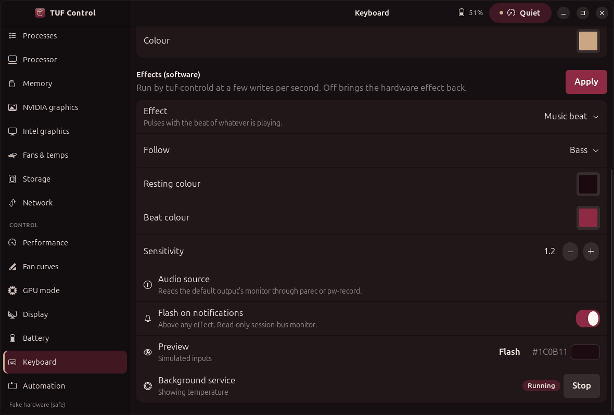
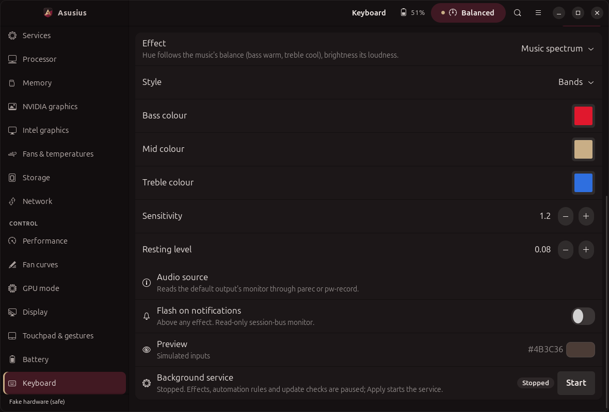
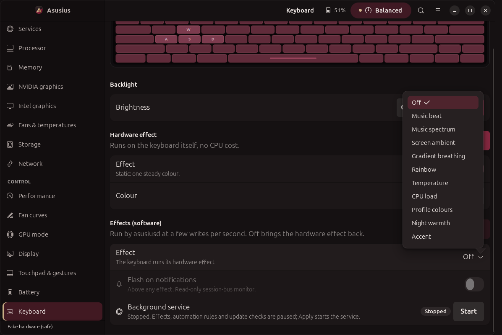
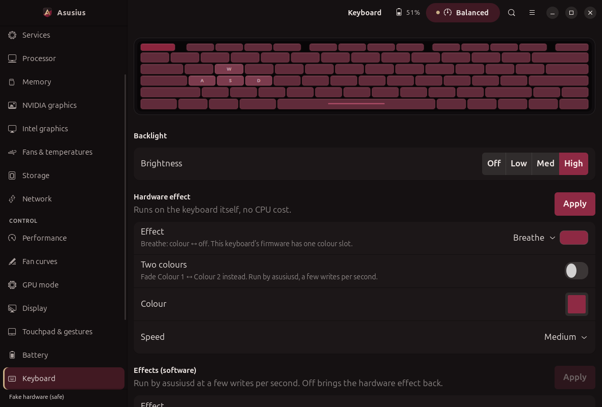
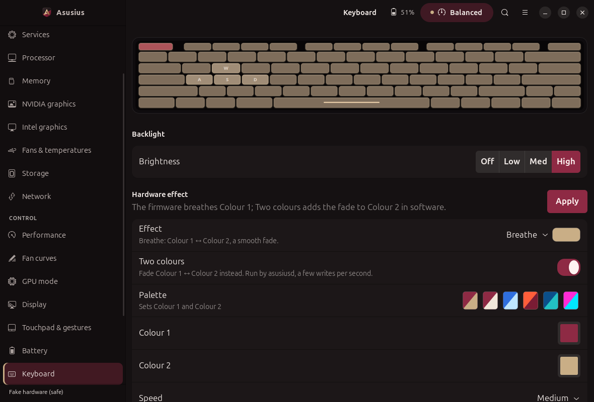

# Keyboard software effects

Single-zone RGB effects computed by `asusiusd` and written to the keyboard as a static
colour through `Controller.set_kbd_effect` (asusd `LedModeData` on real systems). The
hardware mode is saved when an effect starts and written back when effects stop, the daemon
stops, or a rule turns effects off.

## Using them

Keyboard page, **Effects (software)**: pick an effect, adjust its parameters, watch the
preview, **Apply** (writes the config and starts the service if needed). From the CLI:

    asusius kbd effect list
    asusius kbd effect temperature --param source=cpu --param high=85
    asusius kbd effect audio --param band=bass --param peak=#a3283a --notifications on
    asusius kbd effect off

Rules can switch effects too (`{"type": "effect", "name": "audio"}`); a rule's choice
overrides the configured one while the rule is active, then the configured one returns.

## Effects

| name | title in the app | colour from | parameters |
| --- | --- | --- | --- |
| `audio` | Music beat | bass/mid/treble beat envelope of what is playing | `band`, `base`, `peak`, `gain` |
| `spectrum` | Music spectrum | `bands`: hue from the bass/mid/treble balance (bass warm, treble cool), brightness from loudness; `meter`: a VU meter walking bass → mid → treble colour as it gets louder | `style`, `bass`, `mid`, `treble`, `gain`, `floor` |
| `ambient` | Screen ambient | average colour of the screen | `boost` (saturation) |
| `gradient` | Gradient breathing | Colour 1 → Colour 2 → Colour 1 on a cosine ease (each colour lingers), optionally dimmed at the crossing; the hardware Breathe's **Two colours** switch turns it on | `colour1`, `colour2`, `period` (s, full cycle), `dip` (0 = pure gradient, 1 = through black) |
| `rainbow` | Rainbow | a slow walk round the colour wheel | `period`, `saturation` |
| `temperature` | Temperature | CPU/GPU temperature on a cool → warm → hot gradient (lagged ~1.5 s) | `source` cpu/gpu/max, `low`, `high`, `cool`, `warm`, `hot` |
| `cpu` | CPU load | all-core load from `/proc/stat` on an idle → busy → flat-out gradient (~1 s lag) | `low`, `high` (%), `idle`, `busy`, `max` |
| `profile` | Profile colours | platform profile → palette entry (Performance doubles as the game-mode colour) | `quiet`, `balanced`, `performance` |
| `night` | Night warmth | day colour by day; between `start` and `end` (hours) a dim warm amber, with a linear fade | `day`, `night`, `start`, `end`, `fade` (min), `level` |
| `accent` | Accent | one colour, static or breathing; optionally the Bordeaux theme accent | `colour`, `breathe`, `period`, `follow_theme` (off by default) |
| `notifications` (overlay) | Flash on notifications | flashes on desktop notifications above any effect | `colour`, `flashes`, `duration_ms`, `apps` |

`follow_theme` reads, read-only: `~/.config/bordeaux-gnome/variant`, then
`~/.local/state/bordeaux-gnome/variant` (written by the Bordeaux installer), then
`gsettings get org.gnome.shell.extensions.user-theme name`. Bordeaux `#8E2A44`,
Oxblood-Noir `#A3283A`, Merlot-Day `#7A1C34`; anything else falls back to `colour`.

## Engine

- **Plugin interface** (`effects/base.py`): a class with `name`, `title`, `params` (typed
  `Param` schema: colour, int, float, bool, choice, list, with bounds) and
  `tick(dt) -> (r, g, b) | None`. Effects see the world only through `Inputs`
  (telemetry, profile, audio levels, screen frames, notification queue, theme accent), so
  each is tested with synthetic inputs. `None` means "nothing to show".
- **Stack**: layers by priority; the highest layer with a colour wins (the notification
  flash at 100 over the chosen effect at 0). All layers tick every frame.
- **Smoothing**: exponential approach towards the target (`effects.smoothing_s`, 0.25 s),
  frame-rate independent.
- **Rate limit**: compute at `effects.fps` capped per effect (temperature/profile/cpu 8 fps,
  night 2, ambient/rainbow 15, accent/gradient 20, audio/spectrum 30, notification flash 30 while
  flashing); write at most
  `effects.max_write_hz` (default 10) and only when the colour moved by a noticeable amount
  (or every 5 s as a keep-alive). asusd stores each `LedModeData` change in its config, so
  the write rate is deliberately low.
- **Brightness-aware**: the backlight level is read every 2 s; at 0 no writes are sent.
  The colour itself is not scaled: the hardware brightness still applies on top.
- **Failures**: a failed write is reported in the status and retried with back-off
  (2 s, 4 s, ... up to 30 s).
- If a rule sets a static colour while an effect runs, that colour becomes what the effect
  restores when it stops.

## Inputs

### Audio
`parec --device=@DEFAULT_MONITOR@` (PulseAudio or pipewire-pulse; `pw-record -P
stream.capture.sink=true` as a fallback) at 11025 Hz mono, read on a thread. Analysis per
46 ms block: numpy `rfft` when numpy imports, else a pure-Python Goertzel over 12 probe
frequencies (measured here: 0.07 ms vs 0.24 ms per block, well under 1% of a core either
way). Each band has a beat envelope (20 ms attack, 250 ms release) normalised to a slowly
decaying running peak, so quiet and loud music both pulse. The capture process only runs
while the audio effect is active. The monitor of the default sink is what you hear; no
microphone is opened.

### Screen (ambient) — needs permission
GNOME on Wayland gives no silent screen access. The effect uses the
`org.freedesktop.portal.ScreenCast` portal: `CreateSession` → `SelectSources` (one monitor,
cursor hidden, `persist_mode=2`) → `Start` → `OpenPipeWireRemote`, then GStreamer
`pipewiresrc` scaled to 16×9 at 4 fps; dark pixels are ignored and saturation boosted.

- The **first start shows GNOME's screen-sharing dialog**; you pick the monitor. The portal
  returns a restore token, kept in `~/.config/asusius/screencast-token` (mode 600), so
  later starts skip the dialog until you revoke it. Cancelling the dialog clears the token
  and the effect reports `denied`.
- While the effect runs, **GNOME Shell shows its screen-sharing indicator** in the top bar.
  That is intended by GNOME and cannot be hidden.
- Tested against a fake portal bus and fake frame source (handshake order, options, token
  persistence and reuse, denial, averaging). The real dialog and PipeWire stream have not
  been exercised by the test suite.

### Notifications
A second, private session-bus connection calls
`org.freedesktop.DBus.Monitoring.BecomeMonitor` with one match rule for
`org.freedesktop.Notifications.Notify` calls. No eavesdropping flags, no notification server
of our own; the bus allows this for the same user, and a monitor connection cannot send.
Verified by a test on a private `dbus-run-session` bus. Where the bus refuses (sandboxed
sessions), the overlay stays idle and the status says why. Only app name, summary and
urgency are read.

## Hardware effect, software effects and the keyboard

- The hardware **Apply** sends exactly what `asusctl aura effect …` sends (captured with
  `strace` against asusd 6.3.5): `Properties.Set("xyz.ljones.Aura", "LedModeData",
  <(uu(yyy)(yyy)ss) mode zone colour1 colour2 speed-name direction-name>)` on
  `/xyz/ljones/aura/tuf`; modes by number (Static 0, Breathe 1, Colour cycle 2, Pulse 10).
  It then reads `LedModeData` back and fails with a toast naming what asusd reports if the
  write did not take. Picking a mode loads the colours/speed asusd keeps for that mode
  (`AllModeData`; asusd 6.3 lists Pulse there as 9, read as 10).
- If a software effect is on, the hardware Apply first turns it Off and waits (≤ 6 s) until
  asusiusd has handed the keyboard back, so a frame cannot paint over the new mode.
- Frames are Static writes, which asusd also stores as Static's own colour: when effects
  stop, a non-Static mode gets Static's colour put back first, then its own mode.
- Errors are visible: a failed start of asusiusd raises a toast with the daemon's last
  log line; an effect or input error (no `parec`, portal denied, write failures) shows in
  the service row and as a toast once.

## Two-colour Breathe

Why the hardware Breathe shows one colour on the FX608JHR: asusd reports `DeviceType` 2
(`LaptopKeyboardTuf`) for `/xyz/ljones/aura/tuf`, and for that type
`write_effect_and_apply` (asusd/src/aura_laptop/mod.rs, 6.3.5) writes the kernel's
`kbd_rgb_mode` (`kbd_rgb_mode_index`: `cmd mode red green blue speed`) as
`[1, mode, colour1.r, colour1.g, colour1.b, speed]`. `colour2` is accepted, stored and
read back over D-Bus (`LedModeData`, `AllModeData`), but it never reaches the keys, so the
firmware breathes Colour 1 ↔ off whatever Colour 2 is. `asusctl aura effect breathe
--colour ff0000 --colour2 0000ff --speed high` behaves the same (strace: it sends
`(1, 0, (255,0,0), (0,0,255), "Med", "Right")`; it also drops `--speed`).

What the Keyboard page does:

- Rows follow the mode, as asusctl's own per-mode arguments define them: Static, Pulse,
  Comet, Flash take a colour; Breathe and Stars two colours and a speed; Colour cycle and
  Rain a speed; Rainbow wave a speed and direction. The Effect row's subtitle says what
  the mode does (for example "Breathe: Colour 1 ↔ Colour 2, a smooth fade") and a small
  swatch beside the picker animates it.
- On a TUF keyboard, Breathe has a **Two colours** switch. Off: the firmware Breathe,
  Colour 1 ↔ off, said plainly. On: Colour 2 and the palettes appear, and Apply writes the
  hardware Breathe (both colours, so asusd keeps them and it is the mode that returns when
  effects stop), then turns on the software `gradient` effect with Colour 1, Colour 2 and a
  cycle of 6/4/2.5 s for Slow/Medium/Fast; asusiusd is started if needed. Turning the
  switch off (or picking another mode) and Apply turns the software effect off first.
  While `gradient` runs the page shows Breathe with Two colours on, not the Static frames.
- Keyboards whose firmware does show Colour 2 (HID keyboards, `DeviceType` 0/1) get
  Colour 2 directly, no switch.
- Palettes (Wine & Gold, Wine & Ivory, Ice, Sunset, Ocean, Neon) set both colours, in the
  hardware form and for the `gradient` software effect.
- Each mode keeps its own colours: unsaved edits survive switching the picker back and
  forth, and a mode never set before starts with a gold Colour 2 rather than black.
- Apply's read-back now checks Colour 2 as well as the mode and Colour 1.

## Status and caveats

- Run on the real FX608JHR (asusd 6.3.5): hardware Static/Breathe/Colour cycle/Pulse from
  the Keyboard page; asusiusd started from the page, `rainbow`, `cpu`, `night` written
  live and Off restoring the exact previous `LedModeData`; `audio` and `spectrum` against a
  synthetic beat and against real `parec` capture of music playing; `ambient` through the
  real `ScreenColourSource` pipeline with a fake portal and fake frames (the real portal
  dialog needs a person at the desk and was not triggered). All checked by reading
  `LedModeData` back over D-Bus.
- Two-colour Breathe on the same machine: Breathe with `#8E2A44`/`#C9AE86` (the form's
  Wine & Gold plan) and `#FF0000`/`#0000FF` at High applied through the page's Apply path
  and read back exactly (mode, both colours, speed); the `gradient` effect pushed 33 Static
  frames through asusd in 4 s, each read back; the saved Aura state was then restored and
  compared equal. The keys themselves cannot be read back, so "one colour on the keys" rests
  on the asusd source above and the owner's report.
- The screen-sharing portal prompt, its restore token on a real GNOME session and the
  PipeWire/GStreamer stream remain untested by the suite.
- The in-app preview runs the same effect classes on simulated inputs (live telemetry and
  profile, a synthetic 120 bpm beat with off-beat hats, a slow colour drift for the screen,
  a slow CPU-load wave) and never touches the keyboard.
