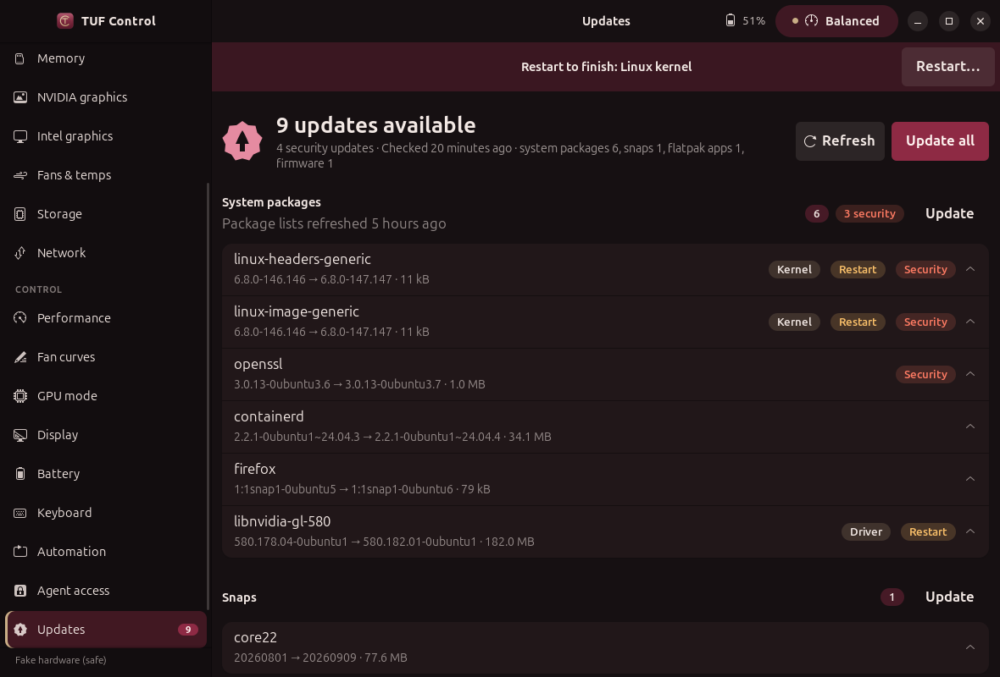
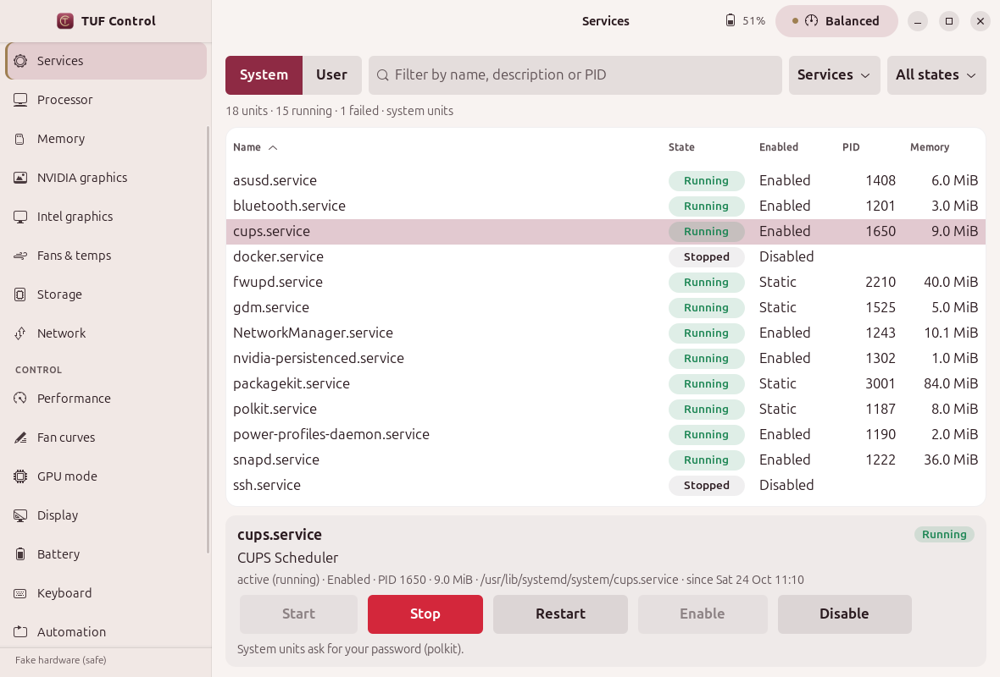

# Updates and Services

## Updates

The **Updates** page (Control → Updates; the sidebar shows a count badge) lists everything on
the laptop that needs an update, grouped by source:

| Source | How it is read (no root, changes nothing) | How it is applied |
|---|---|---|
| System packages (apt: kernel, NVIDIA driver, everything else) | python-apt over the local package cache, like `apt list --upgradable`; fallback `apt-get -s -o Debug::NoLocking=1 dist-upgrade`, then `apt list --upgradable`. Shows when the package lists were last refreshed and marks packages apt holds back (phased). | PackageKit `UpdatePackages` (polkit) |
| Snaps | snapd REST on `/run/snapd.socket`: `/v2/snaps` + `/v2/find?select=refresh` | snapd `POST /v2/snaps` with `X-Allow-Interaction` (polkit) |
| Flatpak (system and per-user) | `flatpak remote-ls --updates --cached` (offline-safe) + `flatpak list` | `flatpak update --user` (no prompt) / `--system` (flatpak's helper, polkit) |
| Firmware (BIOS/UEFI, EC, Thunderbolt, webcam, Secure Boot dbx…) | fwupd D-Bus `GetDevices`, `GetUpgrades` per updatable device, `GetRemotes` for the LVFS metadata age | download the cabinet from the LVFS (https, checksum from the metadata), fwupd `Install` (fwupd verifies the signature; polkit) |
| Restart needed | newer installed kernel of the running flavour, `/run/reboot-required`, NVIDIA kernel module older than the installed driver | GNOME's own restart dialog (`org.gnome.SessionManager.Reboot`) |
| TUF Control / Bordeaux GNOME checkouts (off by default) | `git rev-list HEAD..@{u}` as of the last fetch (no network) | not applied; pull yourself |

A missing source (no flatpak, no fwupd, no snapd) is shown under *Not available* with the reason;
a source that fails (offline, timeout) shows the error and the rest of the report is kept.

**Refresh** renews the metadata through the system services (PackageKit `RefreshCache`,
`fwupdmgr refresh`, flatpak remote summaries) and checks again. **Update all**, per-source
**Update** and per-item **Update** are all behind a confirmation that lists what will happen.
Firmware gets a strong warning (charger connected, battery above 30 %, do not interrupt) and is
never started on battery: the rest of an *Update all* goes ahead and firmware is skipped.
**Open in Software** opens `gnome-software --mode=updates`. The app never runs `sudo` or
`pkexec`; each system service asks polkit, which shows the desktop's own password dialog.

### Background checks

`tuf-controld` checks at most every 6 hours (configurable, minimum 6), skips metered
connections (NetworkManager `Metered`), runs the check in a short-lived child process (one at a
time per user, `flock`), caches the report in `~/.cache/tuf-control/updates.json`, and posts a
desktop notification such as *“4 updates available (apt 3, snap 1) · 2 security”* only when
something new appears (a new item or a newer version). Updates already announced, or seen on
the Updates page, never notify again; fewer updates never notify.

```json
"updates": {"enabled": true, "interval_h": 6, "respect_metered": true, "notify": true,
            "sources": {"apt": true, "snap": true, "flatpak": true, "firmware": true,
                        "system": true},
            "check_repos": false, "repos": ["~/projects/tuf-control", "~/projects/bordeaux-gnome"]}
```
(in `~/.config/tuf-control/config.json`).

### CLI and agents

```
tuf-control updates [list] [--check] [--json]   # cached report, or check now
tuf-control updates check
tuf-control updates refresh [--source apt|firmware|flatpak]
tuf-control updates apply [--source S] [--id ID]   # prints the plan; --yes applies (polkit)
```
MCP agents get one read-only tool, `get_updates` (the cached report; it neither checks nor
installs).

## Services

**Monitor → Services** lists systemd units like Mission Center: name, state chip, enabled,
PID, memory, for **System** or **User** units, with a text filter (name, description, PID),
a type filter (services, timers, sockets, all) and a state filter (running, failed, stopped,
enabled). Selecting a unit shows its description, unit file, main PID and since-when, and
Start / Stop / Restart / Enable / Disable.

* Listing: one `ListUnits` D-Bus call per refresh (every 3 s, only while the page is visible;
  the rows are dropped when it is hidden), `ListUnitFiles` every tenth refresh, PID and memory
  from the unit's cgroup files. No root.
* Actions: systemd's own D-Bus API (`StartUnit`, `StopUnit`, `RestartUnit`,
  `EnableUnitFiles`/`DisableUnitFiles` + `Reload`); user units on the session bus, system units
  on the system bus with interactive authorisation, so systemd asks polkit. Every action has a
  confirmation.
* Safety: only services, sockets, timers and paths; masked/not-found units are refused;
  enable/disable only for `enabled`/`disabled` unit files; stop/restart/disable are refused for
  core units (D-Bus, `systemd-*`, polkit, NetworkManager and Wi-Fi, display managers, `user@`,
  gettys, the GNOME Shell/session/portals/PipeWire, asusd/supergfxd/power-profiles-daemon,
  AppArmor/ufw, and TUF Control's own units). The CLI and the backend apply the same rules.

```
tuf-control services [--user] [list --filter X --state running|failed|... --type timer --sort memory]
tuf-control services show NAME
tuf-control services start|stop|restart|enable|disable NAME [--user] [--dry-run]
```

## Tests and screenshots

`tests/test_updates.py` and `tests/test_services.py` feed every parser recorded output
(`tests/fixtures/updates/`), test the notification dedupe, the scheduler cadence, the safety
rules and the D-Bus calls against recorders; a stand-in snapd runs on a private socket. Actions
are only exercised in fake mode (`TUF_CONTROL_FAKE_ROOT`), where they are written to a log.
`tests/ui/screenshots_system.py` renders both pages (dark and light) with fake data and drives
an update-all and a service start through their confirmations.

 
